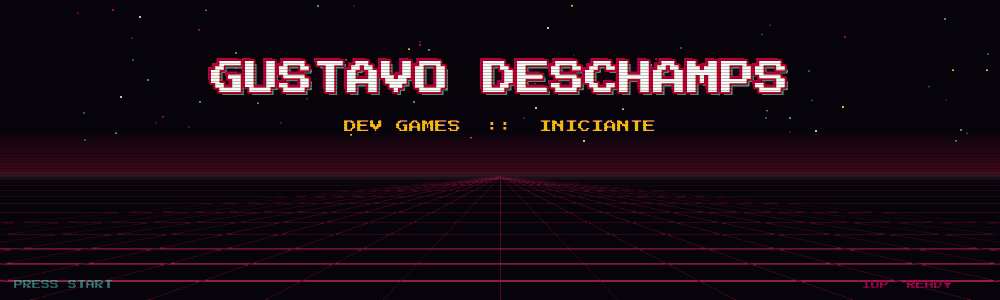
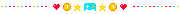
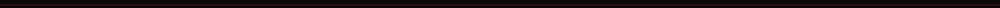
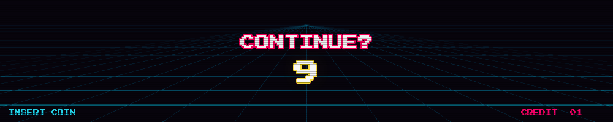

 

 

  

 

 

Estudante de Desenvolvimento de Sistemas em Blumenau (SC). 
Gosto de Java, bancos de dados, jogos e, principalmente, de criar soluções próprias com inteligência artificial. 
Busco minha primeira oportunidade na área de tecnologia.

  

  

 

 

 

 

  

 

<table align="center">
  <tr>
    <td align="center" width="190">
       
      <b>GYDE</b> EM DESENVOLVIMENTO
    </td>
    <td>
      Projeto pessoal de IA que reúne diferentes modelos em uma só aplicação, aproveitando o ponto forte de cada um.
        
      
    </td>
  </tr>
  <tr>
    <td align="center">
      
       
      <b>BLUALERT</b> 1º LUGAR NO HACKATHON EDUCADC
    </td>
    <td>
      Proposta para a Defesa Civil, criada em equipe no SENAI Blumenau (julho de 2026): registro de ocorrências, análise inicial com IA e priorização de chamados.
        
      Depois do evento, criei sozinho um protótipo para continuar explorando a ideia.
        
      
    </td>
  </tr>
  <tr>
    <td align="center">
       
      <b>OPERATION ZERO</b> EXPERIMENTO COM IA
    </td>
    <td>
      Jogo de tiro tático em 3D que roda no navegador (three.js), com treinamento contra bots e partidas por equipes.
        
      Criei com o Claude Code, em poucos prompts, para explorar até onde a IA consegue chegar na criação de um jogo.
        
      
    </td>
  </tr>
</table>

 

 

 

